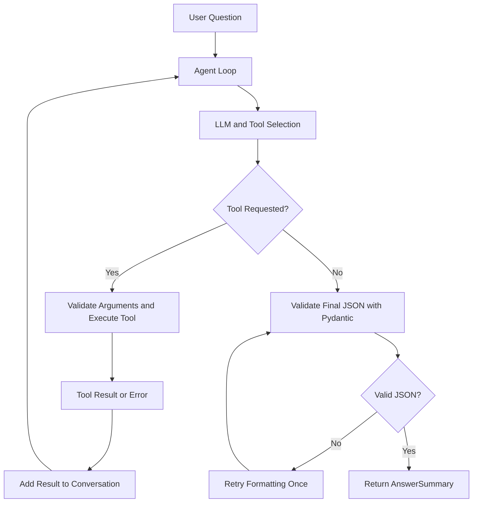

# SmartToolAgent — Custom ReAct AI Agent Framework

SmartToolAgent is a terminal-based AI agent built with Python. It follows a custom **Reason–Act–Observe (ReAct)** loop, selects tools using LLM tool calling, executes Python functions, observes tool results, and returns structured responses validated with Pydantic.

## Features

- **Custom agent loop:** Runs a tool-calling cycle with a configurable maximum step limit.
- **Calculator:** Evaluates mathematical expressions with operation and result-size limits.
- **Weather:** Retrieves weather information using the configured weather tool.
- **SQLite notes:** Saves and retrieves notes.
- **Dynamic tool schemas:** Generates function schemas from Python function signatures.
- **Structured output:** Validates final responses using Pydantic's `AnswerSummary` model and retries once if JSON validation fails.
- **Error handling:** Handles tool failures and LLM request errors without unnecessarily crashing the agent.
- **Configurable LLM provider:** Supports Gemini and Ollama through environment variables.

## Architecture



## Technology Stack

- Python 3.13+
- `uv` for dependency and environment management
- OpenAI-compatible Python client
- Gemini API or Ollama
- Pydantic for data validation
- SQLite for persistent notes
- Open-Meteo weather service (if enabled by the weather tool)

## Prerequisites

- Python 3.13 or a compatible version allowed by `pyproject.toml`
- `uv`
- A Gemini API key, or a locally running Ollama server and a compatible model
- Internet access for hosted LLM and weather requests

Install `uv` using its official installation instructions: https://docs.astral.sh/uv/getting-started/installation/

## Installation

### 1. Clone the repository

```bash
git clone https://github.com/Madhubala288/SmartToolAgent
cd SmartToolAgent
```


### 2. Install dependencies

```bash
uv sync --locked
```

This uses `pyproject.toml` and `uv.lock` to install the project dependencies. If the lock file needs to be regenerated after changing dependencies, run `uv lock` and commit the updated `uv.lock`.

### 3. Configure environment variables

Create a local environment file from the example.

**Windows Command Prompt:**

```cmd
copy .env.example .env
```

**macOS/Linux:**

```bash
cp .env.example .env
```

Open `.env` and configure the provider and model you want to use.

### Gemini configuration

```dotenv
LLM_PROVIDER=gemini
LLM_MODEL=gemini-3.5-flash-lite
LLM_API_KEY=your_gemini_api_key
LLM_BASE_URL=https://generativelanguage.googleapis.com/v1beta/openai/
```

Use a valid model available to your API account. Model availability and quota can change.

### Ollama configuration

First install Ollama and pull a model that supports the required tool-calling features. Start the Ollama server before running the agent.

```dotenv
LLM_PROVIDER=ollama
LLM_MODEL=your_installed_ollama_model
LLM_API_KEY=ollama
LLM_BASE_URL=http://localhost:11434/v1
```

Replace `your_installed_ollama_model` with the exact model name available in your Ollama installation. Compatibility depends on the model and Ollama version.

## Running the Agent

From the project root, run:

```bash
uv run python main.py
```

Enter a question at the prompt. Type `exit` to quit.

Example questions:

```text
What is 25 times 5?
Calculate 10 modulo 3.
Save a note saying review the agent loop.
List my saved notes.
```

The available weather questions depend on the weather tool's supported arguments.

## Example Output

The following illustrates the response structure; the exact wording may vary.

```json
{
  "answer": "25 times 5 is 125.",
  "tools_used": ["calculator"],
  "confidence": 1.0
}
```

- `answer`: The agent's response.
- `tools_used`: The names of tools invoked, including tools whose execution failed.
- `confidence`: A score between `0.0` and `1.0`.

## Testing

Run the automated tests with:

```bash
uv run pytest
```

If a test makes external API calls, ensure the required service and configuration are available. Prefer mocking external calls in automated tests so the test suite can run without paid API usage or network dependencies.

For manual calculator checks:

```bash
uv run python -c "from agent.tools.calculator import calculator; print(calculator('25*5'))"
uv run python -c "from agent.tools.calculator import calculator; print(calculator('10%3'))"
```

Expected outputs:

```text
125
1
```

To check that large exponentiation is rejected:

```bash
uv run python -c "from agent.tools.calculator import calculator; print(calculator('2**1000000000'))"
```

The command is expected to raise a validation error because the exponent exceeds the configured limit.

## Project Structure

```text
SmartToolAgent/
├── data/
├── src/
│   ├── agent/
│   │   ├── config.py
│   │   ├── agent_loop.py
│   │   ├── models.py
│   │   ├── prompts.py
│   │   └── tools/
│   └── schemas/
├── tests/
├── .env.example
├── .gitignore
├── LEARNING_NOTES.md
├── main.py
├── pyproject.toml
└── uv.lock
```

The structure above summarizes the main components; individual files may vary as development continues.

## Security

- Never commit `.env` or share your API key.
- Keep `.env.example` limited to placeholder values.
- Do not put secrets in source code, logs, screenshots, or public documentation.
- Review tool inputs and errors before adding new tools.

## Limitations

- Hosted model availability, rate limits, and response quality depend on the configured provider.
- Ollama models may differ in tool-calling and JSON-mode support.
- Weather requests require network access.
- The agent has a maximum number of steps to limit repeated tool calls.

## Development Notes

See `LEARNING_NOTES.md` for project learning notes and prompt experiments. See `tests/` for the project's test cases and evaluation questions.

## Execution Evidence

The following scenarios should be run and their actual terminal output recorded before submission.

### Run 1 — Calculator Tool

**Input**
```text
What is 25 times 5?
```

**Expected verification:** The calculator tool is called, the answer is `125`, and the final response contains the required fields.

**Actual output:** 
You: what is 25*5?
2026-10-16 11:19:31,852 | INFO | Agent step 1
2026-10-16 11:19:40,596 | INFO | HTTP Request: POST https://generativelanguage.googleapis.com/v1beta/openai/chat/completions "HTTP/1.1 200 OK"
2026-10-16 11:19:40,647 | INFO | Executing tool=calculator arguments={'expression': '25*5'}
2026-10-16 11:19:40,648 | INFO | Tool calculator executed successfully.
2026-10-16 11:19:40,648 | INFO | Agent step 2
2026-10-16 11:19:42,002 | INFO | HTTP Request: POST https://generativelanguage.googleapis.com/v1beta/openai/chat/completions "HTTP/1.1 503 Service Unavailable"
2026-10-16 11:19:42,004 | INFO | Retrying request in 0.463469 seconds (retry 1 of 2)
2026-10-16 11:19:52,110 | INFO | HTTP Request: POST https://generativelanguage.googleapis.com/v1beta/openai/chat/completions "HTTP/1.1 200 OK"
2026-10-16 11:19:52,121 | WARNING | Final response was not valid AnswerSummary JSON: 1 validation error for AnswerSummary
  Invalid JSON: trailing characters at line 1 column 4 [type=json_invalid, input_value='25 * 5 = 125', input_type=str]
    For further information visit https://errors.pydantic.dev/2.13/v/json_invalid
2026-10-16 11:19:59,029 | INFO | HTTP Request: POST https://generativelanguage.googleapis.com/v1beta/openai/chat/completions "HTTP/1.1 200 OK"
2026-10-16 11:19:59,061 | INFO | Final JSON validated successfully after retry.

Agent:
{
  "answer": "25 * 5 = 125",
  "tools_used": [
    "calculator"
  ],
  "confidence": 1.0
}

### Run 2 — Multi-Tool Execution

**Input**
```text
Save a note saying test the agent loop, then show my notes.
```

**Expected verification:** The agent calls `add_note` and `list_notes`, and the saved note appears in the result.

**Actual output:** 
You: Save a note saying test the agent loop, then show my notes.
2026-10-16 11:28:44,783 | INFO | Agent step 1
2026-10-16 11:28:49,609 | INFO | HTTP Request: POST https://generativelanguage.googleapis.com/v1beta/openai/chat/completions "HTTP/1.1 200 OK"
2026-10-16 11:28:49,641 | INFO | Executing tool=add_note arguments={'content': 'test the agent loop'}
2026-10-16 11:28:49,695 | INFO | Tool add_note executed successfully.
2026-10-16 11:28:49,697 | INFO | Agent step 2
2026-10-16 11:28:54,019 | INFO | HTTP Request: POST https://generativelanguage.googleapis.com/v1beta/openai/chat/completions "HTTP/1.1 200 OK"
2026-10-16 11:28:54,048 | INFO | Executing tool=list_notes arguments={}
2026-10-16 11:28:54,053 | INFO | Tool list_notes executed successfully.
2026-10-16 11:28:54,053 | INFO | Agent step 3
2026-10-16 11:28:56,189 | INFO | HTTP Request: POST https://generativelanguage.googleapis.com/v1beta/openai/chat/completions "HTTP/1.1 503 Service Unavailable"
2026-10-16 11:28:56,191 | INFO | Retrying request in 0.378892 seconds (retry 1 of 2)
2026-10-16 11:28:57,554 | INFO | HTTP Request: POST https://generativelanguage.googleapis.com/v1beta/openai/chat/completions "HTTP/1.1 503 Service Unavailable"
2026-10-16 11:28:57,557 | INFO | Retrying request in 0.957737 seconds (retry 2 of 2)
2026-10-16 11:29:02,797 | INFO | HTTP Request: POST https://generativelanguage.googleapis.com/v1beta/openai/chat/completions "HTTP/1.1 200 OK"
2026-10-16 11:29:02,801 | WARNING | Final response was not valid AnswerSummary JSON: 1 validation error for AnswerSummary
  Invalid JSON: expected ident at line 1 column 2 [type=json_invalid, input_value='I have successfully save...10. test the agent loop', input_type=str]
    For further information visit https://errors.pydantic.dev/2.13/v/json_invalid
2026-10-16 11:29:06,716 | INFO | HTTP Request: POST https://generativelanguage.googleapis.com/v1beta/openai/chat/completions "HTTP/1.1 200 OK"
2026-10-16 11:29:06,724 | INFO | Final JSON validated successfully after retry.

Agent:
{
  "answer": "I have successfully saved the note \"test the agent loop\". Here are all your current notes:\n\n1. Learn agent loops\n2. complete smart tool agent setup\n3. complete smart tool agent setup\n4. Complete my Agentic AI assignment\n5. Learn agent loops\n6. Learn agent loops\n7. My project is SmartToolAgent\n8. Learn agent loops\n9. Learn agent loops\n10. test the agent loop",
  "tools_used": [
    "add_note",
    "list_notes"
  ],
  "confidence": 1.0
}


### Run 3 — Error Handling

**Input**
```text
Calculate 2 raised to the power of 1000000000.
```

**Expected verification:** The calculator rejects the excessive exponent, the tool error is handled, and the agent attempts to return a valid final response.

**Actual output:** 
You: Calculate 2 raised to the power of 1000000000.
2026-10-16 11:30:15,261 | INFO | Agent step 1
2026-10-16 11:30:20,326 | INFO | HTTP Request: POST https://generativelanguage.googleapis.com/v1beta/openai/chat/completions "HTTP/1.1 200 OK"
2026-10-16 11:30:20,333 | INFO | Executing tool=calculator arguments={'expression': '2 ** 1000000000'}
2026-10-16 11:30:20,348 | ERROR | Tool execution failed: calculator
Traceback (most recent call last):
  File "D:\laptop data\Agentic AI internship at Dawoodtech NextGen\SmartToolAgent\src\agent\agent_loop.py", line 180, in run_agent
    result = execute_tool(tool_name, arguments)
  File "D:\laptop data\Agentic AI internship at Dawoodtech NextGen\SmartToolAgent\src\agent\agent_loop.py", line 42, in execute_tool
    return tool_function(**arguments)
  File "D:\laptop data\Agentic AI internship at Dawoodtech NextGen\SmartToolAgent\src\agent\tools\calculator.py", line 100, in calculator
    return evaluate(tree)
  File "D:\laptop data\Agentic AI internship at Dawoodtech NextGen\SmartToolAgent\src\agent\tools\calculator.py", line 56, in evaluate
    return evaluate(node.body)
  File "D:\laptop data\Agentic AI internship at Dawoodtech NextGen\SmartToolAgent\src\agent\tools\calculator.py", line 78, in evaluate
    raise ValueError(
        f"Exponent magnitude cannot exceed {MAX_EXPONENT}."
    )
ValueError: Exponent magnitude cannot exceed 1000.
2026-10-16 11:30:20,427 | INFO | Agent step 2
2026-10-16 11:30:25,263 | INFO | HTTP Request: POST https://generativelanguage.googleapis.com/v1beta/openai/chat/completions "HTTP/1.1 200 OK"
2026-10-16 11:30:25,274 | WARNING | Final response was not valid AnswerSummary JSON: 1 validation error for AnswerSummary
  Invalid JSON: expected value at line 1 column 1 [type=json_invalid, input_value='The calculator tool retu...f the resulting number.', input_type=str]
    For further information visit https://errors.pydantic.dev/2.13/v/json_invalid
2026-10-16 11:30:29,181 | INFO | HTTP Request: POST https://generativelanguage.googleapis.com/v1beta/openai/chat/completions "HTTP/1.1 200 OK"
2026-10-16 11:30:29,202 | INFO | Final JSON validated successfully after retry.

Agent:
{
  "answer": "The calculator tool returned an error because the exponent magnitude cannot exceed 1000. Therefore, calculating $2^{1,000,000,000}$ directly is not supported due to the extreme size of the resulting number.",
  "tools_used": [
    "calculator"
  ],
  "confidence": 1.0
}

Bilkul, isi format mein remaining questions de rahi hoon. Aap har question ka output khud copy-paste kar dena.

### Run 4 — Calculator: Addition and Subtraction

Input

```
Calculate 75 + 125 - 50.
```

Expected verification: The `calculator` tool executes successfully and returns `150`.

Actual output:


```
You: Calculate 75 + 125 - 50.
2026-10-16 15:35:29,749 | INFO | Agent step 1
2026-10-16 15:35:35,890 | INFO | HTTP Request: POST https://generativelanguage.googleapis.com/v1beta/openai/chat/completions "HTTP/1.1 200 OK"
2026-10-16 15:35:35,916 | INFO | Executing tool=calculator arguments={'expression': '75 + 125 - 50'}
2026-10-16 15:35:35,917 | INFO | Tool calculator executed successfully.
2026-10-16 15:35:35,918 | INFO | Agent step 2
2026-10-16 15:35:43,574 | INFO | HTTP Request: POST https://generativelanguage.googleapis.com/v1beta/openai/chat/completions "HTTP/1.1 200 OK"
2026-10-16 15:35:43,593 | WARNING | Final response was not valid AnswerSummary JSON: 1 validation error for AnswerSummary
  Invalid JSON: trailing characters at line 1 column 4 [type=json_invalid, input_value='75 + 125 - 50 = 150', input_type=str]
    For further information visit https://errors.pydantic.dev/2.13/v/json_invalid
2026-10-16 15:35:48,010 | INFO | HTTP Request: POST https://generativelanguage.googleapis.com/v1beta/openai/chat/completions "HTTP/1.1 200 OK"
2026-10-16 15:35:48,016 | INFO | Final JSON validated successfully after retry.

Agent:
{
  "answer": "75 + 125 - 50 = 150",
  "tools_used": [
    "calculator"
  ],
  "confidence": 1.0
}
```

### Run 5 — Calculator: Percentage

Input

```
What is 15% of 240?
```

Expected verification: The `calculator` tool calculates the percentage correctly and returns `36`.

Actual output:

```
You: What is 15% of 240?
2026-10-16 15:37:29,460 | INFO | Agent step 1
2026-10-16 15:37:44,431 | INFO | HTTP Request: POST https://generativelanguage.googleapis.com/v1beta/openai/chat/completions "HTTP/1.1 200 OK"
2026-10-16 15:37:44,535 | INFO | Executing tool=calculator arguments={'expression': '240 * 0.15'}
2026-10-16 15:37:44,537 | INFO | Tool calculator executed successfully.
2026-10-16 15:37:44,538 | INFO | Agent step 2
2026-10-16 15:38:04,807 | INFO | HTTP Request: POST https://generativelanguage.googleapis.com/v1beta/openai/chat/completions "HTTP/1.1 503 Service Unavailable"
2026-10-16 15:38:04,809 | INFO | Retrying request in 0.402109 seconds (retry 1 of 2)
2026-10-16 15:38:07,670 | INFO | HTTP Request: POST https://generativelanguage.googleapis.com/v1beta/openai/chat/completions "HTTP/1.1 200 OK"
2026-10-16 15:38:07,674 | WARNING | Final response was not valid AnswerSummary JSON: 1 validation error for AnswerSummary
  Invalid JSON: trailing characters at line 1 column 3 [type=json_invalid, input_value='15% of 240 is 36.', input_type=str]
    For further information visit https://errors.pydantic.dev/2.13/v/json_invalid
2026-10-16 15:38:37,451 | INFO | HTTP Request: POST https://generativelanguage.googleapis.com/v1beta/openai/chat/completions "HTTP/1.1 200 OK"
2026-10-16 15:38:37,455 | INFO | Final JSON validated successfully after retry.

Agent:
{
  "answer": "15% of 240 is 36.",
  "tools_used": [
    "calculator"
  ],
  "confidence": 1.0
}
```

### Run 6 — Weather: Karachi

Input

```
What is the current weather at latitude 24.8607 and longitude 67.0011?
```

Expected verification: The `get_weather` tool retrieves current weather information for the supplied coordinates.

Actual output:

```
You: What is the current weather at latitude 24.8607 and longitude 67.0011?
2026-10-16 15:38:54,489 | INFO | Agent step 1
2026-10-16 15:39:22,556 | INFO | HTTP Request: POST https://generativelanguage.googleapis.com/v1beta/openai/chat/completions "HTTP/1.1 200 OK"
2026-10-16 15:39:22,559 | INFO | Executing tool=get_weather arguments={'latitude': 24.8607, 'longitude': 67.0011}
2026-10-16 15:39:29,668 | INFO | HTTP Request: GET https://api.open-meteo.com/v1/forecast?latitude=24.8607&longitude=67.0011&current=temperature_2m%2Crelative_humidity_2m%2Capparent_temperature%2Cwind_speed_10m "HTTP/1.1 200 OK"
2026-10-16 15:39:29,670 | INFO | Tool get_weather executed successfully.
2026-10-16 15:39:29,670 | INFO | Agent step 2
2026-10-16 15:39:51,281 | INFO | HTTP Request: POST https://generativelanguage.googleapis.com/v1beta/openai/chat/completions "HTTP/1.1 200 OK"
2026-10-16 15:39:51,287 | WARNING | Final response was not valid AnswerSummary JSON: 1 validation error for AnswerSummary
  Invalid JSON: expected value at line 1 column 1 [type=json_invalid, input_value='The current weather at l...Wind Speed:** 12.9 km/h', input_type=str]
    For further information visit https://errors.pydantic.dev/2.13/v/json_invalid
2026-10-16 15:39:55,217 | INFO | HTTP Request: POST https://generativelanguage.googleapis.com/v1beta/openai/chat/completions "HTTP/1.1 200 OK"
2026-10-16 15:39:55,228 | INFO | Final JSON validated successfully after retry.

Agent:
{
  "answer": "The current weather at latitude 24.8607 and longitude 67.0011 is:\n\n- Temperature: 33.4°C (Apparent: 36.7°C)\n- Humidity: 53%\n- Wind Speed: 12.9 km/h",
  "tools_used": [
    "get_weather"
  ],
  "confidence": 1.0
}

```

### Run 7 — Weather: Lahore

Input

```
Get the current weather at latitude 31.5204 and longitude 74.3587.
```

Expected verification: The `get_weather` tool retrieves weather information for the supplied coordinates.

Actual output:

```
You: Get the current weather at latitude 31.5204 and longitude 74.3587.
2026-10-16 15:40:13,034 | INFO | Agent step 1
2026-10-16 15:40:27,174 | INFO | HTTP Request: POST https://generativelanguage.googleapis.com/v1beta/openai/chat/completions "HTTP/1.1 200 OK"
2026-10-16 15:40:27,176 | INFO | Executing tool=get_weather arguments={'longitude': 74.3587, 'latitude': 31.5204}
2026-10-16 15:40:29,000 | INFO | HTTP Request: GET https://api.open-meteo.com/v1/forecast?latitude=31.5204&longitude=74.3587&current=temperature_2m%2Crelative_humidity_2m%2Capparent_temperature%2Cwind_speed_10m "HTTP/1.1 200 OK"
2026-10-16 15:40:29,002 | INFO | Tool get_weather executed successfully.
2026-10-16 15:40:29,003 | INFO | Agent step 2
2026-10-16 15:40:34,278 | INFO | HTTP Request: POST https://generativelanguage.googleapis.com/v1beta/openai/chat/completions "HTTP/1.1 200 OK"
2026-10-16 15:40:34,282 | WARNING | Final response was not valid AnswerSummary JSON: 1 validation error for AnswerSummary
  Invalid JSON: expected value at line 1 column 1 [type=json_invalid, input_value='The current weather at l...*Wind Speed:** 3.0 km/h', input_type=str]
    For further information visit https://errors.pydantic.dev/2.13/v/json_invalid
2026-10-16 15:40:40,227 | INFO | HTTP Request: POST https://generativelanguage.googleapis.com/v1beta/openai/chat/completions "HTTP/1.1 200 OK"
2026-10-16 15:40:40,229 | INFO | Final JSON validated successfully after retry.

Agent:
{
  "answer": "The current weather at latitude 31.5204 and longitude 74.3587 is:\n- **Temperature:** 27.8°C (Apparent temperature: 29.9°C)\n- **Humidity:** 53%\n- **Wind Speed:** 3.0 km/h",
  "tools_used": [
    "get_weather"
  ],
  "confidence": 1.0
}
```

### Run 8 — Weather: Islamabad

Input

```
What is the weather at latitude 33.6844 and longitude 73.0479?
```

Expected verification: The `get_weather` tool retrieves weather information or handles a weather-service error appropriately.

Actual output:

```
You: What is the weather at latitude 33.6844 and longitude 73.0479?
2026-10-16 15:41:33,044 | INFO | Agent step 1
2026-10-16 15:41:37,300 | INFO | HTTP Request: POST https://generativelanguage.googleapis.com/v1beta/openai/chat/completions "HTTP/1.1 200 OK"
2026-10-16 15:41:37,305 | INFO | Executing tool=get_weather arguments={'longitude': 73.0479, 'latitude': 33.6844}
2026-10-16 15:41:39,856 | INFO | HTTP Request: GET https://api.open-meteo.com/v1/forecast?latitude=33.6844&longitude=73.0479&current=temperature_2m%2Crelative_humidity_2m%2Capparent_temperature%2Cwind_speed_10m "HTTP/1.1 200 OK"
2026-10-16 15:41:39,859 | INFO | Tool get_weather executed successfully.
2026-10-16 15:41:39,859 | INFO | Agent step 2
2026-10-16 15:41:43,554 | INFO | HTTP Request: POST https://generativelanguage.googleapis.com/v1beta/openai/chat/completions "HTTP/1.1 503 Service Unavailable"
2026-10-16 15:41:43,559 | INFO | Retrying request in 0.376373 seconds (retry 1 of 2)
2026-10-16 15:41:49,537 | INFO | HTTP Request: POST https://generativelanguage.googleapis.com/v1beta/openai/chat/completions "HTTP/1.1 200 OK"
2026-10-16 15:41:49,539 | WARNING | Final response was not valid AnswerSummary JSON: 1 validation error for AnswerSummary
  Invalid JSON: expected value at line 1 column 1 [type=json_invalid, input_value='The current weather at l...*Wind Speed:** 3.1 km/h', input_type=str]
    For further information visit https://errors.pydantic.dev/2.13/v/json_invalid
2026-10-16 15:41:54,137 | INFO | HTTP Request: POST https://generativelanguage.googleapis.com/v1beta/openai/chat/completions "HTTP/1.1 200 OK"
2026-10-16 15:41:54,141 | INFO | Final JSON validated successfully after retry.

Agent:
{
  "answer": "The current weather at latitude 33.6844 and longitude 73.0479 is:\n- Temperature: 26.4°C (Apparent: 26.5°C)\n- Humidity: 40%\n- Wind Speed: 3.1 km/h",
  "tools_used": [
    "get_weather"
  ],
  "confidence": 1.0
}
```

### Run 9 — Notes: Save a Study Note

Input

```
Save a note saying I need to study tool calling.
```

Expected verification: The `add_note` tool saves the note successfully and the agent confirms the action.

Actual output:

```
You: Save a note saying I need to study tool calling.
2026-10-16 15:42:08,908 | INFO | Agent step 1
2026-10-16 15:42:13,253 | INFO | HTTP Request: POST https://generativelanguage.googleapis.com/v1beta/openai/chat/completions "HTTP/1.1 200 OK"
2026-10-16 15:42:13,257 | INFO | Executing tool=add_note arguments={'content': 'I need to study tool calling.'}
2026-10-16 15:42:13,303 | INFO | Tool add_note executed successfully.
2026-10-16 15:42:13,304 | INFO | Agent step 2
2026-10-16 15:42:32,840 | INFO | HTTP Request: POST https://generativelanguage.googleapis.com/v1beta/openai/chat/completions "HTTP/1.1 200 OK"
2026-10-16 15:42:32,845 | WARNING | Final response was not valid AnswerSummary JSON: 1 validation error for AnswerSummary
  Invalid JSON: expected ident at line 1 column 2 [type=json_invalid, input_value='I have saved a note sayi...to study tool calling."', input_type=str]
    For further information visit https://errors.pydantic.dev/2.13/v/json_invalid
2026-10-16 15:42:39,225 | INFO | HTTP Request: POST https://generativelanguage.googleapis.com/v1beta/openai/chat/completions "HTTP/1.1 200 OK"
2026-10-16 15:42:39,229 | INFO | Final JSON validated successfully after retry.

Agent:
{
  "answer": "I have saved a note saying: \"I need to study tool calling.\"",
  "tools_used": [
    "add_note"
  ],
  "confidence": 1.0
}

```

### Run 10 — Notes: Save a README Reminder

Input

```
Save a note saying complete the Week 1 README.
```

Expected verification: The `add_note` tool saves the reminder successfully.

Actual output:

```
You: Save a note saying complete the Week 1 README.
2026-10-16 15:43:17,770 | INFO | Agent step 1
2026-10-16 15:43:28,996 | INFO | HTTP Request: POST https://generativelanguage.googleapis.com/v1beta/openai/chat/completions "HTTP/1.1 200 OK"
2026-10-16 15:43:29,000 | INFO | Executing tool=add_note arguments={'content': 'complete the Week 1 README'}
2026-10-16 15:43:29,012 | INFO | Tool add_note executed successfully.
2026-10-16 15:43:29,013 | INFO | Agent step 2
2026-10-16 15:43:38,042 | INFO | HTTP Request: POST https://generativelanguage.googleapis.com/v1beta/openai/chat/completions "HTTP/1.1 200 OK"
2026-10-16 15:43:38,048 | WARNING | Final response was not valid AnswerSummary JSON: 1 validation error for AnswerSummary
  Invalid JSON: expected ident at line 1 column 2 [type=json_invalid, input_value='I have successfully save...ete the Week 1 README".', input_type=str]
    For further information visit https://errors.pydantic.dev/2.13/v/json_invalid
2026-10-16 15:43:50,178 | INFO | HTTP Request: POST https://generativelanguage.googleapis.com/v1beta/openai/chat/completions "HTTP/1.1 200 OK"
2026-10-16 15:43:50,181 | INFO | Final JSON validated successfully after retry.

Agent:
{
  "answer": "I have successfully saved your note: \"complete the Week 1 README\".",
  "tools_used": [
    "add_note"
  ],
  "confidence": 1.0
}
```

### Run 11 — Notes: Retrieve Saved Notes

Input

```
Show me my saved notes.
```

Expected verification: The `list_notes` tool retrieves the saved notes.

Actual output:

```
You: Show me my saved notes.
2026-10-16 15:44:00,246 | INFO | Agent step 1
2026-10-16 15:44:13,945 | INFO | HTTP Request: POST https://generativelanguage.googleapis.com/v1beta/openai/chat/completions "HTTP/1.1 200 OK"
2026-10-16 15:44:13,948 | INFO | Executing tool=list_notes arguments={}
2026-10-16 15:44:13,953 | INFO | Tool list_notes executed successfully.
2026-10-16 15:44:13,953 | INFO | Agent step 2
2026-10-16 15:44:22,741 | INFO | HTTP Request: POST https://generativelanguage.googleapis.com/v1beta/openai/chat/completions "HTTP/1.1 200 OK"
2026-10-16 15:44:22,795 | WARNING | Final response was not valid AnswerSummary JSON: 1 validation error for AnswerSummary
  Invalid JSON: expected value at line 1 column 1 [type=json_invalid, input_value='Here are your saved note...plete the Week 1 README', input_type=str]
    For further information visit https://errors.pydantic.dev/2.13/v/json_invalid
2026-10-16 15:44:30,869 | INFO | HTTP Request: POST https://generativelanguage.googleapis.com/v1beta/openai/chat/completions "HTTP/1.1 200 OK"
2026-10-16 15:44:40,322 | INFO | Final JSON validated successfully after retry.

Agent:
{
  "answer": "Here are your saved notes:\n\n1. Learn agent loops\n2. complete smart tool agent setup\n3. complete smart tool agent setup\n4. Complete my Agentic AI assignment\n5. Learn agent loops\n6. Learn agent loops\n7. My project is SmartToolAgent\n8. Learn agent loops\n9. Learn agent loops\n10. test the agent loop\n11. Learn agent loops\n12. I need to study tool calling.\n13. complete the Week 1 README",
  "tools_used": [
    "list_notes"
  ],
  "confidence": 1.0
}
```

### Run 12 — Calculator: Combined Calculation

Input

```
What is 45 * 12 + 30?
```

Expected verification: The `calculator` tool evaluates the expression correctly and returns `570`.

Actual output:

```
You: What is 45 * 12 + 30?
2026-10-16 15:45:50,900 | INFO | Agent step 1
2026-10-16 15:46:13,463 | INFO | HTTP Request: POST https://generativelanguage.googleapis.com/v1beta/openai/chat/completions "HTTP/1.1 200 OK"
2026-10-16 15:46:13,467 | INFO | Executing tool=calculator arguments={'expression': '45 * 12 + 30'}
2026-10-16 15:46:13,473 | INFO | Tool calculator executed successfully.
2026-10-16 15:46:13,473 | INFO | Agent step 2
2026-10-16 15:46:20,238 | INFO | HTTP Request: POST https://generativelanguage.googleapis.com/v1beta/openai/chat/completions "HTTP/1.1 200 OK"
2026-10-16 15:46:20,307 | WARNING | Final response was not valid AnswerSummary JSON: 1 validation error for AnswerSummary
  Invalid JSON: trailing characters at line 1 column 4 [type=json_invalid, input_value='45 * 12 + 30 = 570', input_type=str]
    For further information visit https://errors.pydantic.dev/2.13/v/json_invalid
2026-10-16 15:46:36,666 | INFO | HTTP Request: POST https://generativelanguage.googleapis.com/v1beta/openai/chat/completions "HTTP/1.1 200 OK"
2026-10-16 15:46:36,728 | INFO | Final JSON validated successfully after retry.

Agent:
{
  "answer": "45 * 12 + 30 = 570",
  "tools_used": [
    "calculator"
  ],
  "confidence": 1.0
}
```

### Run 13 — Multi-Tool Execution

Input

```
Save a note saying test the agent loop, then show my notes.
```

Expected verification: The agent calls `add_note` and `list_notes`, and the saved note appears in the result.

Actual output:

```
You: Save a note saying test the agent loop, then show my notes.
2026-10-16 15:46:53,945 | INFO | Agent step 1
2026-10-16 15:47:10,049 | INFO | HTTP Request: POST https://generativelanguage.googleapis.com/v1beta/openai/chat/completions "HTTP/1.1 200 OK"
2026-10-16 15:47:10,052 | INFO | Executing tool=add_note arguments={'content': 'test the agent loop'}
2026-10-16 15:47:10,067 | INFO | Tool add_note executed successfully.
2026-10-16 15:47:10,068 | INFO | Agent step 2
2026-10-16 15:47:15,953 | INFO | HTTP Request: POST https://generativelanguage.googleapis.com/v1beta/openai/chat/completions "HTTP/1.1 200 OK"
2026-10-16 15:47:15,979 | INFO | Executing tool=list_notes arguments={}
2026-10-16 15:47:15,995 | INFO | Tool list_notes executed successfully.
2026-10-16 15:47:15,996 | INFO | Agent step 3
2026-10-16 15:47:21,926 | INFO | HTTP Request: POST https://generativelanguage.googleapis.com/v1beta/openai/chat/completions "HTTP/1.1 200 OK"
2026-10-16 15:47:21,929 | WARNING | Final response was not valid AnswerSummary JSON: 1 validation error for AnswerSummary
  Invalid JSON: expected ident at line 1 column 2 [type=json_invalid, input_value='Note saved successfully....14: test the agent loop', input_type=str]
    For further information visit https://errors.pydantic.dev/2.13/v/json_invalid
2026-10-16 15:47:38,257 | INFO | HTTP Request: POST https://generativelanguage.googleapis.com/v1beta/openai/chat/completions "HTTP/1.1 200 OK"
2026-10-16 15:47:38,262 | INFO | Final JSON validated successfully after retry.

Agent:
{
  "answer": "Note saved successfully. Here are all your saved notes:\n\n- ID 1: Learn agent loops\n- ID 2: complete smart tool agent setup\n- ID 3: complete smart tool agent setup\n- ID 4: Complete my Agentic AI assignment\n- ID 5: Learn agent loops\n- ID 6: Learn agent loops\n- ID 7: My project is SmartToolAgent\n- ID 8: Learn agent loops\n- ID 9: Learn agent loops\n- ID 10: test the agent loop\n- ID 11: Learn agent loops\n- ID 12: I need to study tool calling.\n- ID 13: complete the Week 1 README\n- ID 14: test the agent loop",
  "tools_used": [
    "add_note",
    "list_notes"
  ],
  "confidence": 1.0
}
```

### Run 14 — Calculator: Division and Explanation

Input

```
Calculate 1000 / 25 and explain the result.
```

Expected verification: The `calculator` tool returns `40`, and the agent explains the result correctly.

Actual output:

```
You: Calculate 1000 / 25 and explain the result.
2026-10-16 16:28:32,532 | INFO | Agent step 1
2026-10-16 16:28:39,213 | INFO | HTTP Request: POST https://generativelanguage.googleapis.com/v1beta/openai/chat/completions "HTTP/1.1 200 OK"
2026-10-16 16:28:39,244 | INFO | Executing tool=calculator arguments={'expression': '1000 / 25'}
2026-10-16 16:28:39,245 | INFO | Tool calculator executed successfully.
2026-10-16 16:28:39,245 | INFO | Agent step 2
2026-10-16 16:28:43,961 | INFO | HTTP Request: POST https://generativelanguage.googleapis.com/v1beta/openai/chat/completions "HTTP/1.1 200 OK"
2026-10-16 16:28:43,966 | WARNING | Final response was not valid AnswerSummary JSON: 1 validation error for AnswerSummary
  Invalid JSON: trailing characters at line 1 column 6 [type=json_invalid, input_value='1000 divided by 25 is **... ($4 \\times 10 = 40$).', input_type=str]
    For further information visit https://errors.pydantic.dev/2.13/v/json_invalid
2026-10-16 16:28:49,840 | INFO | HTTP Request: POST https://generativelanguage.googleapis.com/v1beta/openai/chat/completions "HTTP/1.1 200 OK"
2026-10-16 16:28:49,847 | INFO | Final JSON validated successfully after retry.

Agent:
{
  "answer": "1000 divided by 25 is 40. Explanation: To calculate this, you can think of it as: How many 25s are in 100? There are 4 (since 4 x 25 = 100). Since you are dividing 1000 (which is 100 x 10), you simply multiply that result by 10 (4 x 10 = 40).",
  "tools_used": [
    "calculator"
  ],
  "confidence": 1.0
}

```

### Run 15 — Multi-Tool Execution: Weather and Note

Input

```
What is the current weather at latitude 24.8607 and longitude 67.0011, and save a note saying check today's weather?
```

Expected verification: The agent calls `get_weather` and `add_note`. The note should be saved even if the weather API fails, provided the agent continues execution after the tool error.

Actual output:

```
You: What is the current weather at latitude 24.8607 and longitude 67.0011, and save a note saying check today's weather?
2026-10-16 15:48:24,229 | INFO | Agent step 1
2026-10-16 15:48:34,578 | INFO | HTTP Request: POST https://generativelanguage.googleapis.com/v1beta/openai/chat/completions "HTTP/1.1 200 OK"
2026-10-16 15:48:34,580 | INFO | Executing tool=get_weather arguments={'latitude': 24.8607, 'longitude': 67.0011}
2026-10-16 15:48:37,183 | INFO | HTTP Request: GET https://api.open-meteo.com/v1/forecast?latitude=24.8607&longitude=67.0011&current=temperature_2m%2Crelative_humidity_2m%2Capparent_temperature%2Cwind_speed_10m "HTTP/1.1 503 Service Unavailable"
2026-10-16 15:48:37,189 | ERROR | Tool execution failed: get_weather
Traceback (most recent call last):
  File "D:\laptop data\Agentic AI internship at Dawoodtech NextGen\SmartToolAgent\src\agent\agent_loop.py", line 180, in run_agent
    result = execute_tool(tool_name, arguments)
  File "D:\laptop data\Agentic AI internship at Dawoodtech NextGen\SmartToolAgent\src\agent\agent_loop.py", line 42, in execute_tool
    return tool_function(**arguments)
  File "D:\laptop data\Agentic AI internship at Dawoodtech NextGen\SmartToolAgent\src\agent\tools\weather.py", line 21, in get_weather
    response.raise_for_status()
    ~~~~~~~~~~~~~~~~~~~~~~~~~^^
  File "D:\laptop data\Agentic AI internship at Dawoodtech NextGen\SmartToolAgent\.venv\Lib\site-packages\httpx\_models.py", line 829, in raise_for_status
    raise HTTPStatusError(message, request=request, response=self)
httpx.HTTPStatusError: Server error '503 Service Unavailable' for url 'https://api.open-meteo.com/v1/forecast?latitude=24.8607&longitude=67.0011&current=temperature_2m%2Crelative_humidity_2m%2Capparent_temperature%2Cwind_speed_10m'
For more information check: https://developer.mozilla.org/en-US/docs/Web/HTTP/Status/503
2026-10-16 15:48:37,351 | INFO | Executing tool=add_note arguments={'content': "check today's weather"}
2026-10-16 15:48:37,356 | INFO | Tool add_note executed successfully.
2026-10-16 15:48:37,356 | INFO | Agent step 2
2026-10-16 15:48:42,056 | INFO | HTTP Request: POST https://generativelanguage.googleapis.com/v1beta/openai/chat/completions "HTTP/1.1 200 OK"
2026-10-16 15:48:42,060 | WARNING | Final response was not valid AnswerSummary JSON: 1 validation error for AnswerSummary
  Invalid JSON: expected value at line 1 column 1 [type=json_invalid, input_value='The note "check today\'s...Please try again later.', input_type=str]
    For further information visit https://errors.pydantic.dev/2.13/v/json_invalid
2026-10-16 15:48:47,004 | INFO | HTTP Request: POST https://generativelanguage.googleapis.com/v1beta/openai/chat/completions "HTTP/1.1 200 OK"
2026-10-16 15:48:47,006 | INFO | Final JSON validated successfully after retry.

Agent:
{
  "answer": "The note \"check today's weather\" has been successfully saved. However, I was unable to retrieve the current weather because the weather service returned a 503 Service Unavailable error. Please try again later.",
  "tools_used": [
    "get_weather",
    "add_note"
  ],
  "confidence": 0.95
}

```