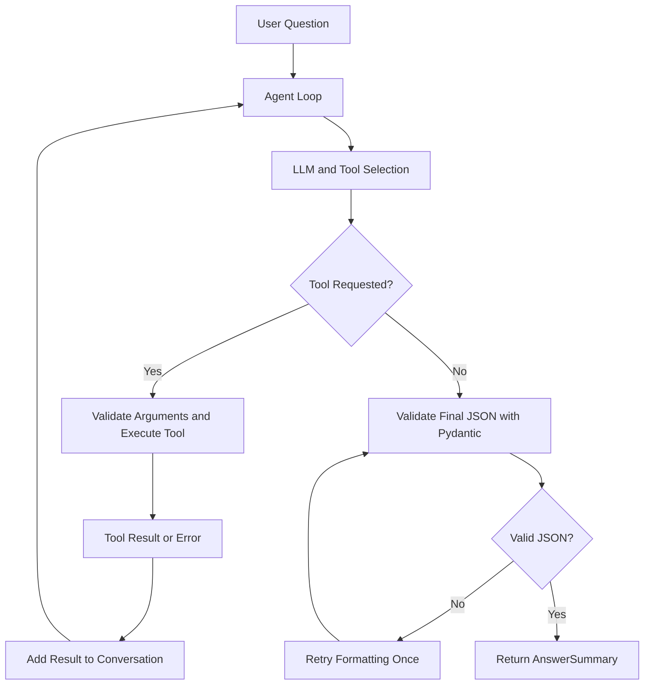

# SmartToolAgent — Custom ReAct AI Agent Framework

SmartToolAgent is a terminal-based AI agent built with Python. It follows a custom **Reason–Act–Observe (ReAct)** loop, selects tools using LLM tool calling, executes Python functions, observes tool results, and returns structured responses validated with Pydantic.

## Features

- **Custom agent loop:** Runs a tool-calling cycle with a configurable maximum step limit.
- **Calculator:** Evaluates mathematical expressions with operation and result-size limits.
- **Weather:** Retrieves weather information using the configured weather tool.
- **SQLite notes:** Saves and retrieves notes.
- **Dynamic tool schemas:** Generates function schemas from Python function signatures.
- **Structured output:** Validates final responses using Pydantic's `AnswerSummary` model and retries once if JSON validation fails.
- **Error handling:** Handles tool failures and LLM request errors without unnecessarily crashing the agent.
- **Configurable LLM provider:** Supports Gemini and Ollama through environment variables.

## Architecture



## Technology Stack

- Python 3.13+
- `uv` for dependency and environment management
- OpenAI-compatible Python client
- Gemini API or Ollama
- Pydantic for data validation
- SQLite for persistent notes
- Open-Meteo weather service (if enabled by the weather tool)

## Prerequisites

- Python 3.13 or a compatible version allowed by `pyproject.toml`
- `uv`
- A Gemini API key, or a locally running Ollama server and a compatible model
- Internet access for hosted LLM and weather requests

Install `uv` using its official installation instructions: https://docs.astral.sh/uv/getting-started/installation/

## Installation

### 1. Clone the repository

```bash
git clone https://github.com/Madhubala288/SmartToolAgent
cd SmartToolAgent
```


### 2. Install dependencies

```bash
uv sync --locked
```

This uses `pyproject.toml` and `uv.lock` to install the project dependencies. If the lock file needs to be regenerated after changing dependencies, run `uv lock` and commit the updated `uv.lock`.

### 3. Configure environment variables

Create a local environment file from the example.

**Windows Command Prompt:**

```cmd
copy .env.example .env
```

**macOS/Linux:**

```bash
cp .env.example .env
```

Open `.env` and configure the provider and model you want to use.

### Gemini configuration

```dotenv
LLM_PROVIDER=gemini
LLM_MODEL=gemini-3.5-flash-lite
LLM_API_KEY=your_gemini_api_key
LLM_BASE_URL=https://generativelanguage.googleapis.com/v1beta/openai/
```

Use a valid model available to your API account. Model availability and quota can change.

### Ollama configuration

First install Ollama and pull a model that supports the required tool-calling features. Start the Ollama server before running the agent.

```dotenv
LLM_PROVIDER=ollama
LLM_MODEL=your_installed_ollama_model
LLM_API_KEY=ollama
LLM_BASE_URL=http://localhost:11434/v1
```

Replace `your_installed_ollama_model` with the exact model name available in your Ollama installation. Compatibility depends on the model and Ollama version.

## Running the Agent

From the project root, run:

```bash
uv run python main.py
```

Enter a question at the prompt. Type `exit` to quit.

Example questions:

```text
What is 25 times 5?
Calculate 10 modulo 3.
Save a note saying review the agent loop.
List my saved notes.
```

The available weather questions depend on the weather tool's supported arguments.

## Example Output

The following illustrates the response structure; the exact wording may vary.

```json
{
  "answer": "25 times 5 is 125.",
  "tools_used": ["calculator"],
  "confidence": 1.0
}
```

- `answer`: The agent's response.
- `tools_used`: The names of tools invoked, including tools whose execution failed.
- `confidence`: A score between `0.0` and `1.0`.

## Testing

Run the automated tests with:

```bash
uv run pytest
```

If a test makes external API calls, ensure the required service and configuration are available. Prefer mocking external calls in automated tests so the test suite can run without paid API usage or network dependencies.

For manual calculator checks:

```bash
uv run python -c "from agent.tools.calculator import calculator; print(calculator('25*5'))"
uv run python -c "from agent.tools.calculator import calculator; print(calculator('10%3'))"
```

Expected outputs:

```text
125
1
```

To check that large exponentiation is rejected:

```bash
uv run python -c "from agent.tools.calculator import calculator; print(calculator('2**1000000000'))"
```

The command is expected to raise a validation error because the exponent exceeds the configured limit.

## Project Structure

```text
SmartToolAgent/
├── data/
├── src/
│   ├── agent/
│   │   ├── config.py
│   │   ├── agent_loop.py
│   │   ├── models.py
│   │   ├── prompts.py
│   │   └── tools/
│   └── schemas/
├── tests/
├── .env.example
├── .gitignore
├── LEARNING_NOTES.md
├── main.py
├── pyproject.toml
└── uv.lock
```

The structure above summarizes the main components; individual files may vary as development continues.

## Security

- Never commit `.env` or share your API key.
- Keep `.env.example` limited to placeholder values.
- Do not put secrets in source code, logs, screenshots, or public documentation.
- Review tool inputs and errors before adding new tools.

## Limitations

- Hosted model availability, rate limits, and response quality depend on the configured provider.
- Ollama models may differ in tool-calling and JSON-mode support.
- Weather requests require network access.
- The agent has a maximum number of steps to limit repeated tool calls.

## Development Notes

See `LEARNING_NOTES.md` for project learning notes and prompt experiments. See `tests/` for the project's test cases and evaluation questions.

## Execution Evidence

The following evidence was collected from actual SmartToolAgent runs on October 16, 2026. It demonstrates calculator execution, multi-tool execution, error handling, and Pydantic validation of the final response.

### Run 1 — Calculator Tool

**Input**

```text
What is 25*5?
```

**Actual execution evidence**

```text
Agent step 1
Executing tool=calculator arguments={'expression': '25*5'}
Tool calculator executed successfully.
Agent step 2
WARNING: Final response was not valid AnswerSummary JSON.
Final JSON validated successfully after retry.
```

**Final output**

```json
{
  "answer": "25 * 5 = 125",
  "tools_used": [
    "calculator"
  ],
  "confidence": 1.0
}
```

**Result:** The calculator executed successfully and returned `125`. The initial response failed JSON validation, but the retry produced a valid `AnswerSummary`.

### Run 2 — Multi-Tool Execution

**Input**

```text
Save a note saying test the agent loop, then show my notes.
```

**Actual execution evidence**

```text
Executing tool=add_note arguments={'content': 'test the agent loop'}
Tool add_note executed successfully.
Executing tool=list_notes arguments={}
Tool list_notes executed successfully.
WARNING: Final response was not valid AnswerSummary JSON.
Final JSON validated successfully after retry.
```

**Final output**

```json
{
  "answer": "I have successfully saved the note \"test the agent loop\". Here are all your current notes: ...",
  "tools_used": [
    "add_note",
    "list_notes"
  ],
  "confidence": 1.0
}
```

**Result:** Both tools executed successfully. The note was saved and the notes list was returned. The final response became valid after a JSON validation retry.

### Run 3 — Error Handling

**Input**

```text
Calculate 2 raised to the power of 1000000000.
```

**Actual execution evidence**

```text
Executing tool=calculator arguments={'expression': '2 ** 1000000000'}
ERROR: Tool execution failed: calculator
ValueError: Exponent magnitude cannot exceed 1000.
WARNING: Final response was not valid AnswerSummary JSON.
Final JSON validated successfully after retry.
```

**Final output**

```json
{
  "answer": "The calculator tool returned an error because the exponent magnitude cannot exceed 1000. Therefore, calculating 2**1000000000 directly is not supported due to the extreme size of the resulting number.",
  "tools_used": [
    "calculator"
  ],
  "confidence": 1.0
}
```

**Result:** The calculator rejected the excessive exponent, the agent handled the tool error, and the final response passed JSON validation after retry.

### Execution Evidence Summary

| Scenario | Tools executed | Observed result |
|---|---|---|
| Calculator | `calculator` | Returned `125`; JSON validated after retry |
| Multi-tool execution | `add_note`, `list_notes` | Both tools succeeded; JSON validated after retry |
| Error handling | `calculator` | Excessive exponent rejected; error handled; JSON validated after retry |

**Note:** These three runs demonstrate selected functionality; they do not represent completion of all 15 evaluation questions. See `tests/questions.md` for the individual test cases and their recorded statuses.